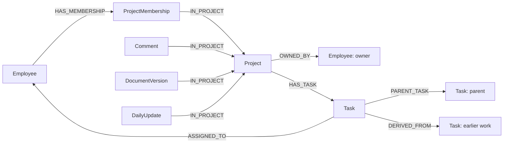
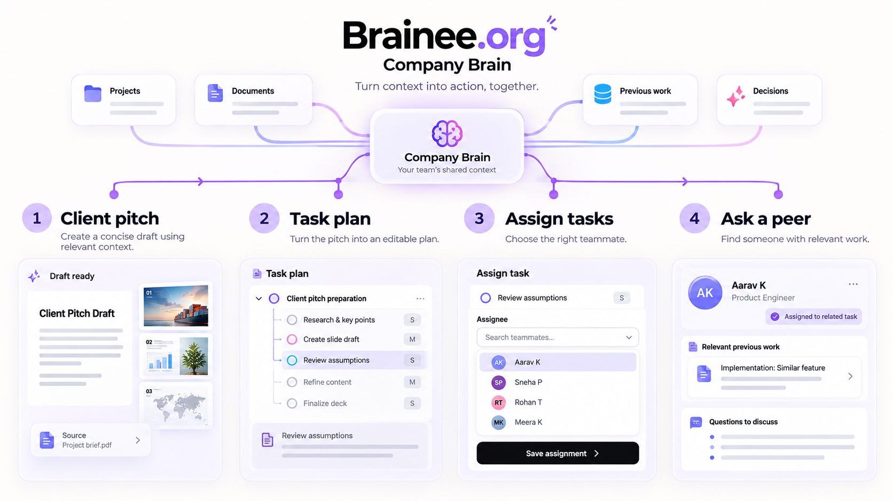

# Brainee.org

Understand how your company works as a system at any given moment, so you can adjust individual parts to improve overall performance.

Brainee is a workspace for a team's projects, tasks, documents and people. Company Brain is the assistant inside it. It uses the team's records to help prepare client pitches, plan work and find colleagues who have worked on similar features.

For example, if a new project needs checkout, you can look up related work, read the decisions behind it and use the old task breakdown as a starting point. You can then review the new tasks, assign them and find someone to ask about the implementation.

The workspace also handles daily updates, leave, WFH requests and equipment.

## Try the demo

The local demo uses Northstar Studio, a fictional company with 14 people, 10 projects and 70 tasks. Sign in as CEO Aditi Deshmukh to try the steps below. You can switch to another teammate to see their view of the workspace.

1. Ask for a client pitch: “Put together a pitch for a checkout project using our past work. Show the sources and flag anything we still need to verify.” The assistant opens a draft with presentation and document views. You can export PowerPoint, Word or PDF files.
2. Ask for a task plan: “Find similar checkout work and draft a task breakdown for [project]. Show the old estimates and explain what needs to change.” Use an existing project name. Review the proposals before confirming them.
3. Open the tasks in the project and choose their assignees. Assignment is a separate step from drafting the plan; owners and managers can reassign existing tasks.
4. Ask: “Who was assigned to the earlier checkout tasks? Show me their work and the decisions I should ask them about.” The linked tasks help you decide which colleague to approach.

Pitch drafts need review before sharing with a client. Old estimates can be incomplete, and being assigned to a task does not establish that someone built every part of it. The assistant includes source links so you can check the context.

See the [demo roster and projects](docs/falkordb/STARTUP-DEMO.md). For more document content, `bun run graph:enrich` adds project documents and expands the sample to 170 tasks. Back up first and read the [enrichment notes](docs/falkordb/STARTUP-DEMO.md#detailed-project-content). All of this data is fictional.

## Run locally

You need Bun and Docker Desktop with Docker Compose available. Start Docker, then run these commands from the repository root:

```sh
bun install
cp .dev.vars.example .dev.vars
openssl rand -hex 32
```

Put the generated value in `SESSION_SECRET` in `.dev.vars`. Keep `TEST_AUTH_ENABLED=true`. If you already have a `.dev.vars` file, edit it instead of replacing it.

Set `OPENCODE_API_KEY` to use the assistant with a live model. The example file also has `OPENCODE_ENDPOINT` and `OPENCODE_MODEL`. Without a key, the app runs with a stub that returns basic responses; it won't carry out the demo conversation.

```sh
bun run graph:setup
bun run graph:up
bun run graph:health
bun run graph:seed
bun run dev
```

Open [localhost:3000](http://localhost:3000) and choose a teammate. The local demo doesn't need a password.

`graph:setup` creates local database credentials and writes the service connection to `.dev.vars`. It keeps existing graph passwords. `graph:up` starts FalkorDB, runs migrations and starts the Node and Python services. The first build downloads dependencies and an embedding model, which can take several minutes. Node and Python run in Docker; you don't need to install them separately for this setup.

Seeding only runs when you ask for it. Back up an existing graph before running `graph:seed` or `graph:enrich`. The first upgrade of the old sample updates known demo accounts and staffing once; later seed runs preserve edits. Details are in the [local setup guide](docs/falkordb/LOCAL-SETUP.md).

FalkorDB Browser is at [localhost:3001](http://localhost:3001). The setup guide explains how to connect. Uploaded files use local R2 storage during development. Live assistant conversations send prompts and selected records to the configured chat provider; embeddings are calculated locally.

Public research for pitches is optional. To enable it, run `bunx playwright install chromium`, set a random `BROWSER_SERVICE_TOKEN` of at least 32 characters in `.dev.vars`, keep `BROWSER_SERVICE_URL=http://127.0.0.1:3200`, and start `bun run browser:serve` in another terminal. It reads approved HTTPS hosts; `BROWSER_PUBLIC_HOSTS` adds hosts to that list. Public searches use generic terms without project details. Layout checks cover the preview, not the exported Word or PowerPoint file.

## Graph data model

FalkorDB stores the application data, and R2 stores uploaded files. The app runs on TanStack Start, React and Cloudflare Workers. Server functions call a private Node service that turns typed operations into parameterized Cypher. A Python service uses `graphrag-sdk==1.4.0` to search the same graph.

Projects connect to their members, tasks, decisions and documents. Tasks connect to assignees, parent tasks and any earlier task they were adapted from.



Membership is a node because it has its own role, allocation and history. `PARENT_TASK` points from child to parent; `DERIVED_FROM` points from a new task to its source. Leave requests link to employees, leave types and balances. Equipment assignments link assets to employees and preserve custody history.

Each business record has a label and a string ID. Reference IDs stay on the record, and writes maintain the corresponding edges. Required and unique constraints cover identities and business keys, including one current membership per employee/project and one current assignment per asset. Timestamp fields use epoch milliseconds; calendar dates use ISO date strings.

Search adds `DeliverySearchEntry` nodes containing passage text, embeddings and source fingerprints. These link back to the original records with `EVIDENCE_FOR`. Search checks the current source before returning a hit, so changed or superseded content is rejected. Original files stay in R2.

The full model is in [models.json](shared/graph/models.json), with TypeScript declarations in [src/db/models](src/db/models). See [relationship definitions](shared/graph/relationships.ts) for edge names and directions, and the [graph model reference](docs/falkordb/GRAPH-MODEL.md) for every label and its integrity rules.

Sessions identify the current employee; graph credentials stay on the server. Project access follows administrator status, ownership and current membership. Delivery search lets active employees find delivery records across projects, with HR fields omitted. Changes still require the relevant project permissions, and assistant task proposals require confirmation.

## Queries and algorithms

The [Cypher reference](docs/falkordb/QUERIES-AND-ALGORITHMS.md) has query examples and links to the code. The main pieces are:

- Full-text and local vector search find related work. Reciprocal rank fusion combines the results, then bounded task and comment traversals add context.
- Task-family queries follow parent links. Effort totals sum leaf tasks to avoid counting both a parent estimate and its children.
- Assignee and membership lookups identify colleagues connected to the work.
- Document checks compare versions, checksums and fingerprints before returning source passages.
- Briefings calculate task counts, staffing and availability before the model writes the answer.
- Task creation writes the task number, links, event and audit together. Leave approval updates the request and balance in one write.

The [GraphRAG README](services/graphrag/README.md) covers extraction formats, indexing, search limits and tests.

## Checks and local data

```sh
bun run typecheck
bun run test
bun run build
bun run graph:test
bun run graph:health
```

Graph integration tests use disposable graphs. Standalone service checks are described in the [local setup guide](docs/falkordb/LOCAL-SETUP.md) and [GraphRAG README](services/graphrag/README.md#verification).

```sh
bun run graph:backup
bun run graph:restore-check
bun run graph:down
```

Backups go to `.local/backups/falkordb/`. Restore checks use a separate temporary container. Stopping the stack keeps the data volume. Production access and deployment are human-run; replace demo authentication before using real team data.

## README image

You can generate the illustration separately in ChatGPT's image-generation UI and add it here later. Use this prompt:

> Make a 16:9 illustration for the Brainee.org README. Show one continuous flow: a client pitch draft becomes a task plan, someone chooses task assignees, then a teammate finds a colleague who worked on a similar feature. Label the stages “Client pitch,” “Task plan,” “Assign tasks” and “Ask a peer.” Connect them with a purple line. Add a few source links under the pitch, editable task rows in the plan, an assignee selector, and a colleague card linked to an earlier task. Use white and pale lavender backgrounds, black text and small pink/cyan accents. Use rounded cards and Plus Jakarta Sans or a similar font. Keep text large and sparse. Treat it as a product illustration, with fictional names and no invented results or customer endorsements.

For an animated version, use the same layout in an eight-second loop: highlight the pitch, reveal the plan, show an assignee selection, then highlight the colleague's earlier task. Keep the labels still. Export a GIF or animated WebP with a PNG fallback using an animation-capable tool.

Save the image as `docs/assets/company-brain.png` and add this below the opening description:

```md

```
